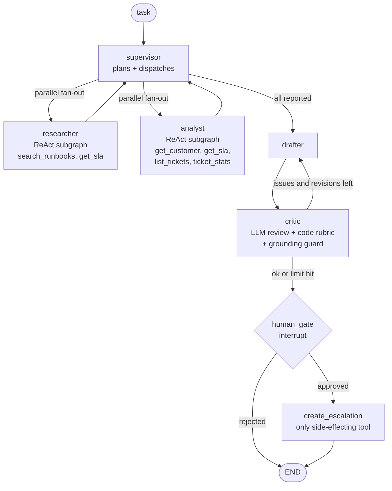

# agentic-ops-copilot

A **hierarchical multi-agent copilot for support operations**, built on **LangGraph**. A supervisor delegates to specialist ReAct agents that run in parallel, a drafter writes the response, a critic sends it back for revision until it passes a rubric, and a human has to approve before any side effect happens. All state is checkpointed to SQLite, so a paused run survives a restart.

I built it to learn the parts of agent systems that decide whether they work in a customer's environment: **state management, guardrails, tracing, and control over side effects** - rather than just chaining prompts.

> **Read this first:** the default backend is a deterministic `RuleBasedLLM` (small hand-written policies per agent) so the whole system runs offline, in milliseconds, with reproducible tests. It does **not** reason, so offline results validate the *orchestration* (routing, parallel delegation, tools, reflection loop, guardrails, approval, persistence), not language-model quality. `--llm gemini` swaps in Gemini through the `google-genai` SDK (Vertex AI or API key); that path is implemented but I have not run it against a live model in this repo.

## Architecture



| Pattern | Where |
|---|---|
| Hierarchical delegation | supervisor -> researcher / analyst, each a separate compiled LangGraph **subgraph** with its own tools and step limit (`react.py`) |
| ReAct | `reason -> act -> reason ...` loop inside every worker; observations feed the next thought |
| Parallel execution | supervisor returns two nodes at once; findings merge through a dict reducer (`state.py`) |
| Self-reflection | drafter -> critic -> drafter loop, bounded by `max_revisions` |
| Human-in-the-loop | `interrupt()` before the only side-effecting tool; resume with `Command(resume=...)` |
| State management | SQLite checkpointer: every superstep is persisted, `history` shows them, a run can resume after a restart |
| Tracing + LLM metrics | each LLM call, tool call and routing decision is an event in the state; per-run calls, tokens, tokens/sec, estimated cost, per-agent breakdown |

## Quick start

```bash
python -m venv .venv && source .venv/bin/activate
pip install -e ".[dev]"

python -m opscopilot.cli run "Customer Cedar Foods says the tracking dashboard is down in EMEA. What is our procedure and who needs to be involved?"
#   -> asks "approve escalation? [y/N]" ; use --approve / --reject to script it
python -m opscopilot.cli history --thread <thread id>   # list the checkpoints of a run
python -m opscopilot.cli eval                            # scenario suite
pytest                                                   # 27 tests, ~1s
```

A real run (full output in [`reports/sample_run_sev1_outage.txt`](reports/sample_run_sev1_outage.txt)):

```
status=completed
## Summary        Found 1 relevant ticket(s): T-27 (SEV1, open, outage).
## Severity and SLA   Business plan: first response for critical issues within 1 hour, uptime 99.9%.
## Next steps     1. ...traffic is drained from the failed region. 3. SEV1 ... must be acknowledged within 5 minutes ...
...
proposed escalation: {"ticket_id": 27, "team": "Platform on-call", ...}
note: escalation created: ticket 27 -> Platform on-call          # only after the human said yes

--- run metrics: 12 LLM calls, 5 tool calls, 1 revision(s), 4329+1262 tokens (approx), est $0.004454
    supervisor llm=2 | analyst llm=4 tools=3 | researcher llm=2 tools=1 | drafter llm=2 | critic llm=2
```

Use Gemini (untested against a live model, see note above):

```bash
export GEMINI_API_KEY=...            # or GOOGLE_GENAI_USE_VERTEXAI=true GOOGLE_CLOUD_PROJECT=... 
python -m opscopilot.cli run "..." --llm gemini
```

## What the tests prove (27 tests)

- **Self-correction:** malformed JSON gets one corrective retry; an unknown tool or bad arguments come back as `ERROR:` observations and the agent recovers on its next turn (`tests/test_react_and_guards.py`).
- **Bounded loops:** step limit forces a final answer from what was gathered; revision limit ends the critic loop with status `max_revisions`; a token budget stops delegation and still produces a (flagged) draft.
- **No hallucinated tickets:** a grounding guard rejects any `T-<id>` in a draft that is not in the workers' findings.
- **Side effects need a human:** the escalation is not executed on reject, and `create_escalation` is not in any worker's tool list.
- **Durable state:** a run paused at the approval gate is dropped, the process "restarts" (new graph, same SQLite file), and resuming completes it (`test_paused_run_survives_a_process_restart`).
- **Injection-inert tools:** SQL is parameterised, column names come from allow-lists, the DB connection is `mode=ro`; tests feed `x'; DROP TABLE tickets; --` through every argument.
- **Parallelism and routing:** both workers run for ticket+policy tasks; a pure policy question skips the data analyst entirely.

## Scenario evaluation (offline)

`python -m opscopilot.cli eval` runs 6 scenarios against the seeded database (19 checks, saved in [`reports/eval_rules.txt`](reports/eval_rules.txt)):

```
api_429_basic_customer               6/6 checks  llm=12 tools=4 rev=1 tokens=5156
sev1_outage_approved                 5/5 checks  llm=12 tools=5 rev=1 tokens=5591
sev1_outage_rejected                 2/2 checks  llm=12 tools=4 rev=1 tokens=5591   (status=rejected, nothing executed)
open_ticket_stats                    1/1 checks  llm=10 tools=2 rev=1 tokens=4009   (counts equal the SQL ground truth)
policy_only_skips_analyst            2/2 checks  llm= 8 tools=1 rev=1 tokens=2936
unknown_customer_no_hallucination    3/3 checks  llm=10 tools=2 rev=1 tokens=4153
TOTAL 19/19
```

**How much to trust this:** the offline policy is mine, and I iterated on it while the scenarios were failing (see below), so 19/19 shows the pipeline wiring and guardrails work, **not** that an LLM solves these tasks. The scenario set exists so the same checks can be pointed at a real model with `--llm gemini` and compared. Token counts are approximations (chars/4) in offline mode, and the price sheet in `config.py` is illustrative - check current Vertex AI pricing.

## Things that went wrong (and what they taught me)

- **Retrieval vocabulary mismatch.** "the tracking dashboard is down" does not share words with a runbook that says "outage" and "SEV1", so BM25 returned the wrong passages and the draft quoted irrelevant policy. A real model rewrites the query; for the offline policy I added explicit query expansion per issue category. Lesson: agent quality is bounded by retrieval, and a researcher agent needs query rewriting.
- **Taking the first N sentences of a retrieved passage as "next steps" produced noise** (a refund question got incident-communication advice). Ranking sentences by overlap with the task fixed it.
- **Parallel branches need reducers.** Researcher and analyst write at the same time; without a dict-merge reducer on `findings` and a list reducer on `trace`, one branch silently overwrote the other.
- **A subgraph's local state also needs a reducer** for its own trace; I first lost every event except the last node's.
- **Re-execution on resume:** an interrupted node re-runs from the top when resumed, so everything before `interrupt()` in `human_gate` must be side-effect free. The escalation is written strictly after the decision.

## Layout

```
src/opscopilot/
  graph.py     parent graph + SQLite checkpointer wiring
  agents.py    supervisor, drafter, critic, human gate; rubric + grounding guards
  react.py     ReAct worker as a LangGraph subgraph
  tools.py     validated tools, BM25 runbook search, read-only DB, the one side-effect tool
  llm.py       GeminiLLM (JSON mode, usage metadata) + RuleBasedLLM (offline stand-in)
  state.py     graph state and reducers
  trace.py     trace events and LLM metrics (calls, tokens, tokens/sec, est. cost)
  runner.py    run + approval loop + JSONL trace export
  eval.py      scenario suite    cli.py   run | history | eval | seed
tests/         27 tests         data/runbooks/   4 fictional runbooks
```

## Build log

| Phase | What I did |
|---|---|
| 1. Tools and data | seeded ticket DB, validated tool layer, runbook search, read-only access |
| 2. Single agent | ReAct loop as a subgraph, JSON protocol, error observations, step limit |
| 3. Multi-agent | supervisor, parallel fan-out, reducers, drafter + critic reflection loop |
| 4. Control | interrupt/resume approval gate, SQLite checkpoints, token budget, grounding guard |
| 5. Observability + eval | trace events, run metrics, scenario suite, fixes for the failures above |

## Limitations / next steps

- Gemini backend not exercised against a live model here; the first thing I would do is run the scenario suite with it and compare to the offline baseline.
- Free-text retrieval is lexical (BM25). Swapping in embeddings (see my companion project `gcp-enterprise-rag`) would reduce the vocabulary-mismatch failure.
- The critic's LLM review and the code rubric overlap; with a strong model I would keep only the checks code can verify and let the LLM judge qualitative issues.
- No auth or multi-tenant isolation; checkpoints live in a local SQLite file (for production I would use a Postgres/Cloud SQL checkpointer).

## How this was built

I built this with an AI coding assistant (Claude Code), working from a scope I set around the Google Cloud AI consulting role: what to build, which patterns to cover, and what to measure. The assistant wrote most of the first version in a single working session in November 2026, including the tests and benchmarks; it was not developed gradually over months. The numbers in this README come from runs of the code in this repo. The "Limitations / next steps" section is work that has not been done yet.

## License

MIT
